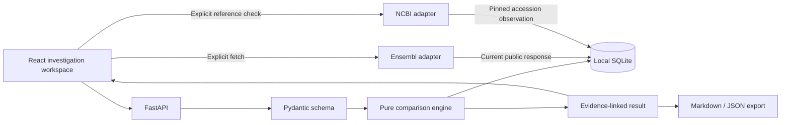

# Architecture and data model

## Current system

The React/TypeScript frontend loads or accepts `InvestigationInput` JSON, sends it to the local FastAPI backend, and displays the returned `InvestigationResult`. The backend separates Pydantic schema validation (`models.py`), deterministic comparison (`engine.py`), immutable regression assertions (`regression.py`), SQLite persistence (`storage.py`), bundle replay checks (`bundle.py`), and Markdown reporting (`report.py`). `main.py` exposes the API. Explicit actions in the Public source panel call `ensembl.py` and `ncbi.py`, each preserving source observations in SQLite. `snpeff.py` compares a supplied VCF without running another engine. No comparison logic makes network calls.

## Data model

- `Snapshot`: stable ID and label; one primary `Variant` and `Annotation`, optional additional annotations for that variant, and optional `variant_records` carrying other exact variants and their annotations; `Provenance` with tool/version, source/release, optional URI/input hash, and configuration map.
- `Variant`: assembly, sequence accession, one-based position, VCF-style nonempty `ref`/`alt`, optional reference context (`start`, `sequence`). Current validation handles A/C/G/T alleles only.
- `Annotation`: gene and transcript IDs, molecular consequence, optional protein consequence, optional clinical assertion. The latter carries framework and condition ID to prevent inappropriate direct comparisons.
- `ControlledLookup`: optional synthetic table bound to a variant. A replay selects transcript rows from the same table and checks all recorded gene/consequence/protein outputs. A unique transcript ID is required per row.
- `InvestigationResult`: canonical-input SHA-256, variant identity result, field differences, findings, and individually addressable evidence objects. Findings contain evidence IDs and a qualitative status (`verified`, `probable`, `possible`, `unresolved`). The current engine does not emit `probable` because it has no calibrated supporting rule for that category.
- `RegressionCase`: immutable copy of one saved investigation and its expected observations, with case schema version and creation time. It is stored separately from the source investigation, so a later source-record change cannot change the baseline.
- `RegressionRun`: pinned or candidate mode, actual recomputed result, required checks, evidence-hash checks, changed input paths, and pass/fail status. A candidate must preserve each original submitted variant exactly; changes to tool or source versions are recorded and may still pass if expected outputs hold.
- `SourceRecord`: immutable local capture of one current VEP response, exact query, one-base Ensembl reference, reported assembly accession/releases, retrieval time, source URLs, response hash, and parsed transcript consequences. A comparison selects two rows from this record and produces ordinary snapshots with matching provenance. It does not add a controlled replay.
- `ReferenceCheck`: immutable local capture tied to one `SourceRecord`. It records the pinned NCBI assembly-report hash, RefSeq accession, EFetch FASTA, contextual SPDI, HGVS response, source URIs/hashes, and agreement flags. A reference mismatch skips the representation requests. A generated transcript comparison includes the latest check summary in the input and its ID/status in both snapshots' provenance. Agreement does not upgrade a causal finding; disagreement makes cross-source identity unresolved and adds linked evidence.
- `SnpEffCheck`: saved user supplied VCF, declared software/database metadata, exact transcript consequence matches and unmatched rows. It can be linked to an Ensembl source comparison, but its provenance is not authenticated.
- Bundle version 2: a current-engine replay of one investigation plus available preserved source/check records. Verification checks entry hashes, source/check raw hashes and IDs, and exact recomputed investigation output. It does not establish external authenticity.

## Comparison decisions

1. Validate inputs, including that each `ref` matches the supplied context.
2. Establish allele identity only when assembly, sequence accession, and reference context exactly agree and both trimmed edits are nonempty substitutions. This trim is **not** a full normalizer. Indels remain unresolved.
3. Compare structured fields and match additional variants by exact submitted representation. Position/ref/alt spelling changes are nonmeaningful only if identity was established. Keep molecular and clinical fields separate.
4. Compare clinical classifications only inside the same condition and framework. Otherwise record a comparability finding.
5. For transcript-related output changes, replay the synthetic table only when the allele, tool, version, source release, and configuration are held constant. A matching replay earns `verified` within the fixture. Otherwise report a possible or unresolved cause.
6. Store the full result locally, including supporting evidence, and export it.

## Adapter boundary

External data enters only on a `mode: fetch` request. `mode: cache_only` never calls Ensembl or NCBI. A live Ensembl fetch checks release and assembly metadata, the one-base reference, and the VEP response, then inserts a separate preserved record. The NCBI adapter requires the report's GRCh38.p14 GenBank assembly accession to match that record, maps its chromosome to a versioned RefSeq accession, and validates one base and two notation responses. Failures use prior cached records only with an explicit warning. A current API response never replaces a historical snapshot. The release number is observed metadata, not proof of an atomic release pin. A future generalized normalized allele service should use a validated sequence repository and standards-aware library, rather than extending the current flank trim to repeats.

SQLite is appropriate for small local investigations. Larger datasets and background jobs may require a queue and a separate data store; those are not part of this release.
