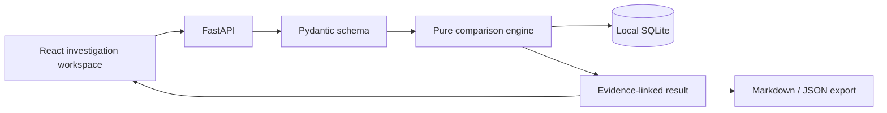

# Architecture and data model

## Current system

The React/TypeScript frontend loads or accepts `InvestigationInput` JSON, sends it to the local FastAPI backend, and displays the returned `InvestigationResult`. The backend separates Pydantic schema validation (`models.py`), deterministic comparison (`engine.py`), immutable regression assertions (`regression.py`), SQLite persistence (`storage.py`), and Markdown reporting (`report.py`). `main.py` exposes the API. No comparison logic makes network calls.

## Data model

- `Snapshot`: stable ID and label; one `Variant`; one `Annotation`; `Provenance` with tool/version, source/release, optional URI/input hash, and configuration map.
- `Variant`: assembly, sequence accession, one-based position, VCF-style nonempty `ref`/`alt`, optional reference context (`start`, `sequence`). Current validation handles A/C/G/T alleles only.
- `Annotation`: gene and transcript IDs, molecular consequence, optional protein consequence, optional clinical assertion. The latter carries framework and condition ID to prevent inappropriate direct comparisons.
- `ControlledLookup`: optional synthetic table bound to a variant. A replay selects transcript rows from the same table and checks all recorded gene/consequence/protein outputs. A unique transcript ID is required per row.
- `InvestigationResult`: canonical-input SHA-256, variant identity result, field differences, findings, and individually addressable evidence objects. Findings contain evidence IDs and a qualitative status (`verified`, `probable`, `possible`, `unresolved`). The current engine does not emit `probable` because it has no calibrated supporting rule for that category.
- `RegressionCase`: immutable copy of one saved investigation and its expected observations, with case schema version and creation time. It is stored separately from the source investigation, so a later source-record change cannot change the baseline.
- `RegressionRun`: pinned or candidate mode, actual recomputed result, required checks, evidence-hash checks, changed input paths, and pass/fail status. A candidate must preserve each original submitted variant exactly; changes to tool or source versions are recorded and may still pass if expected outputs hold.

## Comparison decisions

1. Validate inputs, including that each `ref` matches the supplied context.
2. Establish allele identity only when assembly, sequence accession, and reference context exactly agree and both trimmed edits are nonempty substitutions. This trim is **not** a full normalizer. Indels remain unresolved.
3. Compare structured fields. Position/ref/alt spelling changes are nonmeaningful only if identity was established. Keep molecular and clinical fields separate.
4. Compare clinical classifications only inside the same condition and framework. Otherwise record a comparability finding.
5. For transcript-related output changes, replay the synthetic table only when the allele, tool, version, source release, and configuration are held constant. A matching replay earns `verified` within the fixture. Otherwise report a possible or unresolved cause.
6. Store the full result locally, including supporting evidence, and export it.

## Planned adapters

External data will enter through source adapters that return immutable, versioned records with source URI, accession, release, retrieval time, and content hash. Such adapters must never replace a historical snapshot with a current API response. A future normalized allele service should use a validated sequence repository and standards-aware library, rather than extending the current flank trim to repeats.

SQLite is appropriate for small local investigations. Larger datasets and background jobs may require a queue and a separate data store; those are not part of this release.
