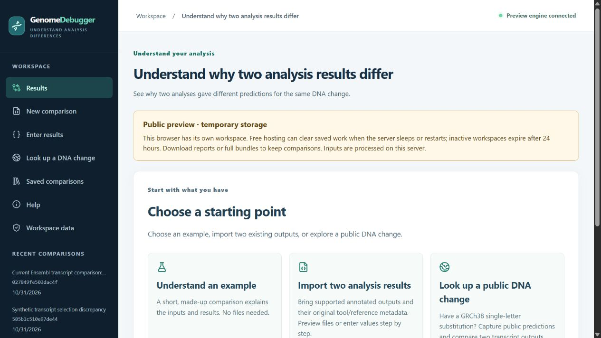

# Public deployment — October 31, 2026

This records the initial 0.9.0 deployment. The subsequent [0.10.0 guided workspace release](guided-workspace-0.10.0-2026-10-31.md) is now live on the same Free service.

[Open GenomeDebugger](https://genomedebugger.onrender.com)

The full React/Python application is live on one Render **Free** Docker web service in Ohio. Application 0.9.0, comparator 0.6.7, SQLite schema 3. The GitHub source repository remains private; the application is publicly accessible.

## Deployment record

- Source: `JustAppTools/GenomeDebugger`, branch `main`.
- Running source commit: `ccb9020ce52309d7b4d0da10e4d30acc17d13ccd`.
- Service: `genomedebugger`, `srv-dbj5biff3r2c73f0bdsg`.
- [Service dashboard](https://dashboard.render.com/web/srv-dbj5biff3r2c73f0bdsg).
- Blueprint: `genomedebugger-free`, `exs-dbj5b967bikc73ef8rj0`.
- Deployment: `dep-dbj5bivf3r2c73f0betg`, reported **Live** after a successful Docker build.
- Budget check: Hobby workspace, Free compute, no card on file, $0 accrued, no persistent disk or managed database.
- Service automatic deployment: off. Blueprint Auto Sync: No. Future updates require an explicit deployment of a tested commit; later documentation commits do not automatically change the running application.
- Session secret generated by Render. No local development database, credentials, or logs included in the image.

## Live verification

All of these checks passed against the actual public HTTPS URL:

- Interface and API health report application 0.9.0, comparator 0.6.7, hosted mode, and temporary storage.
- Synthetic comparison, supplied-context identity verification, saved baseline, and pinned replay.
- Two new visitors receive separate signed workspace cookies. One cannot retrieve the other's records or baselines. Identical deterministic scientific IDs do not share notes.
- Markdown report, full bundle export, explicit bundle import, and valid SQLite backup. Storage information does not disclose server paths.
- Public shutdown is unavailable and local SnpEff execution is disabled.
- Browser example workflow and the prefilled public Ensembl documentation example: reference/source capture, 16 transcript outputs, and comparison of two transcripts. Scientific findings retain their stated uncertainty.

The live HTTP summary is kept locally in `.build/render-live-verification.json`. Tests used synthetic data and the application's public documentation example, without uploading the user's local records. Local original scientific record hashes remain unchanged.

Before deployment, 479 backend tests, 74 frontend tests, the production build, and four HTTPS hosted-browser workflows passed. The local browser suite initially passed 117/118; its asynchronous paging assertion was corrected and passed a focused rerun. This is not a claim of a new uninterrupted 118-scenario run. Render's successful image build supplies the provider-side Docker validation; standalone CLI validation was not used as proof of deployment.

## Free-preview limits

The free service sleeps with inactivity and may take about a minute to wake up. Hosted records are temporary and can disappear on sleep, restart, or redeployment; inactive workspaces expire after 24 hours. Visitors should download full bundles or reports to keep their work. There are no accounts or password recovery. A shared link does not transfer a browser workspace.

Inputs submitted to the preview are processed on the server. This preview does not provide durable hosted storage or clinical interpretation. Installing a local Java/SnpEff database remains a local-app workflow. See [hosting, limits, and data behavior](free-hosting.md).

