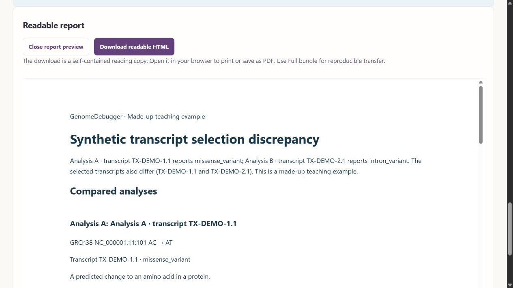

# GenomeDebugger 0.10.1 — repairs from the 0.10.0 audit

Application **0.10.1**, comparator **0.6.8**, SQLite schema **3**. This update repairs the fifteen confirmed findings from the 0.10.0 audit. It does not claim that every possible defect has been discovered.

## Repair coverage

| Audit finding | Corrected behavior |
|---|---|
| A010-01: rejected requests reserve visitor slots | Storage admission follows request validation. Failed first requests discard empty initialized workspaces; useful records and active requests are preserved. HTML and documentation do not allocate a database. |
| A010-02: journal-file race causes 500 | Capacity counts workspace databases, ignores transient SQLite journals, and tolerates missing files. |
| A010-03: shared storage exceeds its limit | The single public-server process serializes database transactions and checks allocated pages before commit. Growth beyond the shared 256 MiB limit rolls back. |
| A010-04: full storage blocks recovery | Downloads, read-only bulk exports, deletion, idempotent comparisons and writes reusing existing pages remain available. Hosted deletion attempts compaction to release shared space; if compaction is unavailable, freed pages can still be reused. |
| A010-05: deletion after navigation leaves stale results | Successful deletion always notifies the parent workspace, even after the library component unmounts. |
| A010-06: hosted storage errors claim local processing | The data panel retains the known deployment mode. Unknown mode uses neutral copy; local restore instructions appear only for confirmed local storage. |
| A010-07: report preview appears below the viewport | Opening focuses and scrolls to the preview. Closing returns focus to its connected trigger. Navigation keeps its own destination focus. |
| A010-08: failed example leaves the wrong URL | Loaded teaching inputs are retained at `#/input` if comparison fails. |
| A010-09: incomplete section links show empty screens | Changes, evidence and test routes without a comparison offer saved-work/input recovery. The disabled Understand step is never marked current. |
| A010-10: draft feedback is silent to screen readers | Persistent polite status feedback announces save, restore, discard and storage errors, including repeated messages. |
| A010-11: term whitespace creates false changes | Engine 0.6.8 trims each compound consequence term before set comparison. Engine 0.6.7 and its regression assertions are archived for historical verification. |
| A010-12: clinical classifications omit their scope | Summary and change views expose every supplied classification's condition, framework, analysis, DNA change and annotation row. Markdown includes this scope for primary and additional rows/variants. |
| A010-13: Markdown hides empty-value distinctions | Difference tables distinguish Not provided, Empty text and Whitespace only. |
| A010-14: group-error links cannot focus fields | Duplicate annotations/variants link to the duplicate row's editable field. Other group constraints have a visible, focusable analysis group and guidance for advanced imported fields. |
| A010-15: valid JSON primitives are called invalid JSON | JSON syntax and the required object shape are assessed separately. Valid primitives receive accurate feedback and cannot be submitted as a comparison. |

Clinical classifications remain declarations from the supplied analyses. GenomeDebugger does not assess clinical significance or issue diagnoses.

## Historical records and local preservation

New comparisons use engine 0.6.8 and receive separate scientific IDs. Existing results are never rewritten under new rules. Bundle verification dispatches 0.6.7 results to the frozen comparator; saved 0.6.7 regression assertions use their original evaluator. Earlier archived versions remain supported.

All **11 original local scientific records** retain their IDs and exact stored JSON hashes after restarting the local application. A consistent database copy also passes complete restore validation, including historical result and regression replay. The local application reports 0.10.1 / 0.6.8. Local data and secrets are excluded from Git and Docker build context.

## Verification

- **491 backend tests** pass (`.build/fix0101-backend-final.log`), including 12 added regression cases. The existing Starlette/anyio deprecation warning remains.
- **90 frontend tests** across 16 files pass (`.build/fix0101-frontend-final.log`), including 16 added regressions.
- TypeScript and production Vite build pass (`.build/fix0101-build-final.log`).
- **128 Chromium/WebKit scenarios pass in one uninterrupted final run** (`.build/fix0101-browser-release.log`), including six new workflows and existing responsive/axe checks.
- **4 hosted HTTPS workflows** pass (`.build/fix0101-browser-hosting-final.log`). Hosted test artifacts now have a separate output directory; the initial overlapping suites collided while writing traces. The final runs are clean.
- npm audit reports **zero known vulnerabilities**, and `pip check` reports no broken requirements.
- Original-record hashes and complete staged-copy restore/replay validation pass. Manual browser checks confirm that an older saved comparison opens, its preview receives focus and scrolls into view, and closing restores the trigger.

Tests use isolated databases and synthetic/public fixtures. Capacity stress and injected failures ran locally, not against the public service.

## Deployment and release scope

**Live: [genomedebugger.onrender.com](https://genomedebugger.onrender.com).** The existing Free service `srv-dbj5biff3r2c73f0bdsg` successfully deployed source `e2a5f713df26958dbc6a96885bd5575687f4988a` through deployment `dep-dbj9p6nlk1mc738kvrkg`. It finished in about 45 seconds, on October 31, 2026 (America/Chicago). The runtime reports application 0.10.1 / engine 0.6.8.

Actual public HTTPS checks pass for the compiled UI assets, runtime versions, synthetic comparisons, compound-term whitespace, clinical condition/framework in Markdown, empty/whitespace distinctions, visitor record isolation, and explicit bundle transfer (`.build/fix0101-live-verification.json`). The browser ran the built-in example and confirmed that report focus moves to its preview; the preview starts at about 16 px and its iframe at about 197 px in the 720 px viewport. No new application error logs were returned during this verification window.

GitHub main also contains the later documentation-only verification commit. Automatic deployments remain disabled, so it does not trigger another deploy. No paid service, database or disk is required. Automatic deployments and Blueprint sync remain off; updates are deployed deliberately. Hosted records are still temporary; visitors should download reports or full bundles for retention.

The shared transaction guard is designed for the existing single-process public service. Multiple independent server processes sharing this workspace directory would require cross-process admission coordination. This update does not enable that deployment mode.
