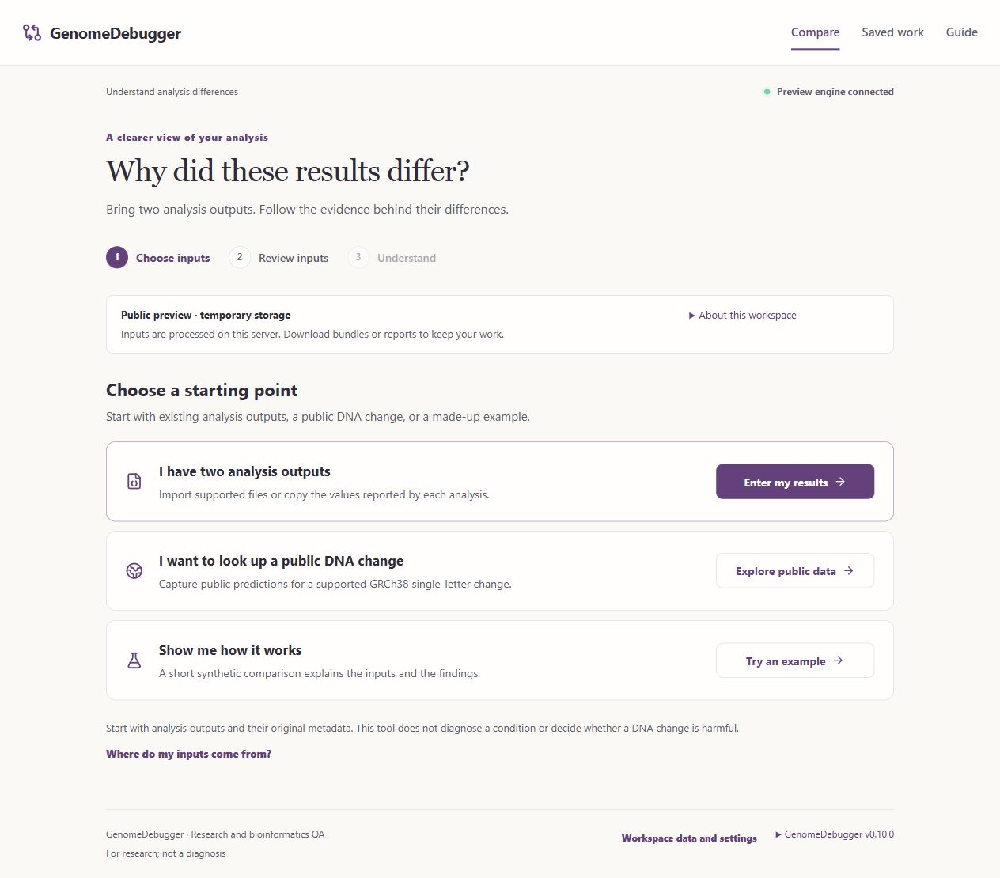

# Guided workspace — application 0.10.0

The interface now centers on choosing two inputs, reviewing them, and understanding the comparison. The persistent dark sidebar has been replaced by a horizontal header with **Compare**, **Saved work**, and **Guide**.

## Interface changes

- Warm neutral page surfaces, plum actions, a simple comparison mark, and a serif page title distinguish the visual design from the former dashboard shell.
- Three starting paths explain the available inputs: two existing analysis outputs, a supported public DNA change, or a clearly synthetic example.
- A visible Choose inputs → Review inputs → Understand navigation keeps the comparison workflow together. Existing guided fields, supported file imports, and complete original JSON remain available.
- Comparison navigation offers Summary, Changes, and Supporting details. Saved tests, input JSON, and explicit rerun actions are under Advanced tools.
- The result starts with its existing plain-language explanation and evidence limits. Exact terms, biological checks, provenance, and original records retain their scientific scope.
- Recent comparisons appear on the home page. Saved work retains organization, notes, archive/restore, paging, and exports.
- Storage/settings move to the footer. The application version is visible there; expanding it shows the separate comparison-engine version.
- Public storage and server-processing notices remain visible, with retention details available on expansion. Visitors still need reports/full bundles to keep temporary hosted work.

Comparator 0.6.7 and SQLite schema 3 are unchanged. Navigation does not change scientific inputs, evidence, record IDs, replay rules, or visitor isolation. No employer screenshot, medical information, or assets from the reference EMR have been included in the source or deployment.

## Verification and publication

- Backend: **479 passed** (`.build/guided-backend-tests.log`), with the existing Starlette/anyio deprecation warning.
- Frontend: **74 passed** (`.build/guided-frontend-final.log`).
- Production TypeScript/Vite build passed: JavaScript 367.24 kB / 108.15 kB gzip; CSS 55.85 kB / 11.63 kB gzip (`.build/guided-build-final.log`).
- Browser: **122 scenarios verified across the final run and a focused rerun** (Chromium/WebKit). The full run passed 121 scenarios, with one Windows worker process exit (3221226505) during the valid-file race test. That scenario passed its focused rerun. Logs: `.build/guided-browser-final.log`, `.build/guided-browser-worker-retest.log`. No uninterrupted 122-scenario pass is claimed.
- Four new workflows cover horizontal navigation and draft retention, evidence/deep links/advanced inputs/version details, and 320px/1280px layouts with core axe checks. The first pass caught a legacy sidebar contrast rule affecting recent record IDs; it has been removed.
- HTTPS public mode: **4 passed**, including visitor isolation, readable reports, bundle transfer, and data-screen accessibility (`.build/guided-browser-hosted.log`).
- Local services restarted at 0.10.0. All 11 original scientific records retain their IDs and stored-result hashes.

## Live publication

[Open GenomeDebugger](https://genomedebugger.onrender.com). The redesign is deployed on the existing **Free** service `srv-dbj5biff3r2c73f0bdsg`, with the same manual-update configuration and no added resources.

- Running source: `c47c5f813d981911e7f5eab91a663d4aa1e04734` from GitHub `main`.
- [Render deployment](https://dashboard.render.com/web/srv-dbj5biff3r2c73f0bdsg/deploys/dep-dbj5ugflk1mc738bhr50): **live**, successful Docker build and health checks.
- Actual public checks passed for application 0.10.0 / engine 0.6.7, new frontend assets, synthetic comparisons, visitor record isolation, Markdown report, and explicit bundle transfer. Summary: `.build/guided-live-verification.json`.
- Browser confirmed the horizontal navigation, three input paths, connected preview engine, temporary storage notice, and visible application version.
- Later documentation-only commits do not automatically redeploy the service. No payment method, paid resource, or duplicate service was added.

